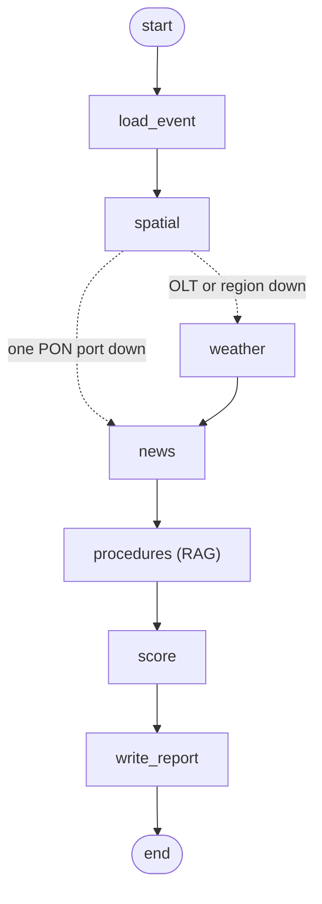

# network-outage-rca-agent

When part of a telecom network goes down, operators want to know **why** before they send a truck: a fiber cut, a car hitting a pole, a power cut, a broken OLT, or a storm. This agent builds a root-cause dossier for an outage event: ranked hypotheses, the evidence behind each one, and the operating procedure to follow.

> **About this repo.** It implements, on synthetic data, an AI proposal I designed at work for a network-monitoring platform. Network, events, weather and news are fictitious; no employer code or data is included.

## How it works



| Step | What it does |
|---|---|
| `spatial` | Classifies the spread: one PON port, a whole OLT, or several OLTs in a region |
| `weather` | Rain, wind gusts and lightning in every affected city during the outage (skipped for single-port faults) |
| `news` | Local headlines for the affected cities on that day |
| `procedures` | Retrieves the relevant operating procedure (TF-IDF retrieval over Markdown docs) |
| `score` | Rule-based scoring; every point is recorded as evidence |
| `write_report` | An LLM writes the dossier **only from the collected evidence**; without an API key, a template is used |

Design choice: the deterministic steps do the reasoning and the LLM only writes. That keeps the cost per analysis low, makes every claim traceable to a data source, and leaves the scoring testable without a model. The data-access functions are LangChain `@tool`s, so the same tools can be bound to a tool-calling model later.

## Run it

```bash
pip install -e ".[dev]"            # add ".[llm]" and set ANTHROPIC_API_KEY for LLM-written reports
python -m rca_agent.synthetic      # regenerate the fictitious network and 40 labeled events
python -m rca_agent.cli analyze EV-0002
python -m rca_agent.cli evaluate
```

Example (template report, no LLM):

```
# Outage EV-0002
2026-09-09 14:45, 187 min · Gamma Ville · 48 ONUs on 1 ports (pon scope)

## Probable causes
- Vehicle impact on a pole (56%)
  - only one PON port down
  - news: "Truck hits utility pole on a main avenue in Gamma Ville; traffic blocked"
- Fiber cut or splitter failure (36%)
```

## Evaluation

`evaluate` runs the graph on 40 labeled synthetic events (the label is hidden from the agent) and compares the top hypothesis with the true cause:

```
top-1 accuracy: 77.5%
errors: vehicle_pole -> fiber_cut 4 · power_outage -> equipment_failure 2 · power_outage -> weather 2 · weather -> power_outage 1
```

The errors happen where external evidence is missing (no news of the pole crash, no report of the power cut), which is the honest limit of this approach: the quality of the dossier depends on the external sources connected. Because the data is synthetic, this number checks that the pipeline works; real accuracy would come from replaying past outages with confirmed causes.

## Tests

```bash
pytest
```

Covers the hidden label, the spatial classification, the conditional routing, retrieval, probability normalization, and that the LLM (a fake model in tests) only writes the report.

## Next steps

- Replace the JSON sources with the network database, a weather API (Open-Meteo) and a news feed
- Swap TF-IDF for embeddings and a vector store when the procedure base grows
- Add LLM-as-judge evaluation of the written dossiers

Stack: Python, LangGraph, LangChain, scikit-learn, Anthropic API (optional).
